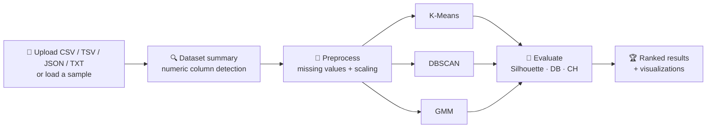

<div align="center">

# 🔬 Hybrid Clustering Analyzer

### Upload a dataset. Run three clustering algorithms. Know which one wins.

A full-stack unsupervised learning workbench that preprocesses your tabular data, runs **K-Means**, **DBSCAN**, and **Gaussian Mixture Models** side by side, and ranks them with standard clustering metrics, all through an interactive UI.

<br />


[Features](#-features) · [Quick Start](#-quick-start) · [How It Works](#-how-it-works) · [API](#-api-reference) · [Algorithms](#-algorithms) · [Metrics](#-evaluation-metrics) · [Troubleshooting](#-troubleshooting)

</div>

---

## ✨ Features

| | |
|---|---|
| 📂 **Flexible uploads** | CSV, TSV, JSON, or TXT files up to **50 MB** |
| 🧪 **Built-in samples** | Iris, blobs, moons, circles, and anisotropic blobs, so you can explore without any data |
| 🎯 **Feature selection** | Pick exactly which numeric columns to cluster on |
| 🧹 **Missing value handling** | Mean, median, zero fill, or drop rows |
| ⚖️ **Scaling options** | `StandardScaler`, `MinMaxScaler`, or none |
| 🤖 **Three algorithms** | K-Means, DBSCAN, and Gaussian Mixture Models |
| 📈 **Auto-K detection** | Elbow-method heuristic finds the K-Means cluster count for you |
| 🔗 **Hybrid mode** | Reuse the K-Means optimal K as the GMM component count |
| 🏆 **Model ranking** | Compare using Silhouette, Davies-Bouldin, and Calinski-Harabasz scores |
| 📊 **Rich visuals** | Elbow curves, cluster scatter plots, cluster size charts, and ranking tables |

---

## 🧭 How It Works



---

## 🚀 Quick Start

### Prerequisites

- Python **3.10+**
- Node.js **18+**
- npm

### 1️⃣ Start the Flask API

<details open>
<summary><b>Windows (PowerShell)</b></summary>

```powershell
cd artifacts\flask-api
python -m venv .venv
.\.venv\Scripts\Activate.ps1
pip install -r requirements.txt
python app.py
```

</details>

<details>
<summary><b>macOS / Linux</b></summary>

```bash
cd artifacts/flask-api
python3 -m venv .venv
source .venv/bin/activate
pip install -r requirements.txt
python app.py
```

</details>

The API runs at **http://127.0.0.1:5000**

### 2️⃣ Start the React UI

In a second terminal, from the project root:

```bash
cd artifacts/clustering-ui
npm install
npm run dev
```

The UI runs at **http://localhost:5173**

> 💡 Vite automatically proxies `/api` requests to `http://127.0.0.1:5000`, so no extra configuration is needed in development.

---

## 🖱️ Usage

1. Open the UI at `http://localhost:5173`
2. **Upload** a dataset or **load a sample**
3. **Review** the dataset summary and detected numeric columns
4. **Configure** algorithms, preprocessing, and model parameters
5. **Run** the analysis
6. **Compare** models in the ranking table and explore each algorithm's visualizations

---

## 🗂️ Project Structure

```text
artifacts/
├── flask-api/
│   ├── app.py              # Flask routes and in-memory sessions
│   ├── preprocessing.py    # Dataset loading, summaries, scaling, missing values
│   ├── clustering.py       # K-Means, DBSCAN, and GMM wrappers
│   ├── evaluation.py       # Clustering metrics and model ranking
│   └── requirements.txt    # Python dependencies
└── clustering-ui/
    ├── src/
    │   ├── App.tsx
    │   ├── components/     # Dataset, configuration, and results UI
    │   └── lib/api.ts      # API response helper
    ├── package.json        # Frontend scripts and dependencies
    └── vite.config.ts      # Vite config and /api proxy
```

---

## 🧠 Algorithms

### K-Means
Uses `sklearn.cluster.KMeans` with `k-means++` initialization and `n_init=10`. If `n_clusters` is not provided, the API tests values from `1` to `max_k` and estimates the **elbow point** from WCSS (inertia).

### DBSCAN
Uses `sklearn.cluster.DBSCAN` with configurable `eps` and `min_samples`. Noise points are labeled `-1`. Great for arbitrary shapes like moons and circles.

### Gaussian Mixture Model
Uses `sklearn.mixture.GaussianMixture` with a configurable component count and covariance type. The response includes **cluster probabilities**, **average assignment confidence**, **AIC**, and **BIC**.

---

## 📐 Evaluation Metrics

| Metric | Goal | Notes |
|---|:---:|---|
| **Silhouette score** | ⬆️ Higher | How well points fit their own cluster vs. neighbors |
| **Davies-Bouldin index** | ⬇️ Lower | Average similarity between each cluster and its closest one |
| **Calinski-Harabasz score** | ⬆️ Higher | Ratio of between-cluster to within-cluster dispersion |
| **Composite score** | ⬆️ Higher | Average of Silhouette and scaled negative Davies-Bouldin |

DBSCAN noise points are ignored where appropriate.

---

## 🔌 API Reference

Base URL: `http://127.0.0.1:5000`

| Method | Endpoint | Description |
|:---:|---|---|
| `GET` | `/api/healthz` | Health check |
| `GET` | `/api/samples` | List sample datasets |
| `POST` | `/api/upload` | Load a dataset and create an in-memory session |
| `POST` | `/api/analyze` | Run clustering on an uploaded dataset |
| `GET` | `/api/results` | Fetch stored results, metrics, and labels |

### `POST /api/upload`

Accepts either a multipart upload (`file`) or a JSON body to load a sample:

```json
{
  "use_sample": true,
  "sample_name": "iris"
}
```

### `POST /api/analyze`

```json
{
  "session_id": "your-session-id",
  "algorithms": ["kmeans", "dbscan", "gmm"],
  "scaling_method": "standard",
  "handle_missing": "mean",
  "feature_columns": [],
  "kmeans_params": {
    "n_clusters": null,
    "max_k": 10,
    "random_state": 42
  },
  "dbscan_params": {
    "eps": 0.5,
    "min_samples": 5
  },
  "gmm_params": {
    "n_components": null,
    "covariance_type": "full",
    "random_state": 42
  }
}
```

> Leave `n_clusters` as `null` to auto-detect K with the elbow method. Leave `n_components` as `null` to reuse the K-Means optimal K for GMM.

### `GET /api/results`

```text
/api/results?session_id=<id>&include_points=true
```

| Parameter | Values | Description |
|---|---|---|
| `session_id` | string | Session returned by `/api/upload` |
| `algorithm` | `kmeans` \| `dbscan` \| `gmm` | Optional filter |
| `include_points` | `true` \| `false` | Include point-level data |

---

## 🛠️ Build and Checks

```bash
cd artifacts/clustering-ui

npm run typecheck   # TypeScript type check
npm run build       # Production build
npm run serve       # Preview the production build
```

---

## ⚠️ Notes

- **Sessions live in memory.** Uploaded datasets and results disappear when the Flask process restarts.
- **Numeric columns only.** Categorical columns appear in the dataset summary but are not encoded.
- **The UI expects `/api`.** Run the Vite dev server or configure an equivalent proxy in production.
- **Single-feature datasets** reuse the same feature on the y-axis of scatter plots.

---

## 🩺 Troubleshooting

| Problem | Fix |
|---|---|
| UI shows API errors | Confirm Flask is running on `http://127.0.0.1:5000` |
| Upload fails | Check the file is CSV, TSV, JSON, or TXT and under 50 MB |
| Clustering won't run | Make sure the dataset has at least one numeric column |
| DBSCAN labels everything as noise | Increase `eps` or decrease `min_samples` |

---

<div align="center">

**If this project helped you, consider giving it a ⭐**

</div>
